# VideoTube

A self-hosted video sharing site in plain PHP and MySQL: uploads are transcoded in the background, served through access-checked endpoints, and come with channels, comments, likes, subscriptions and moderation.

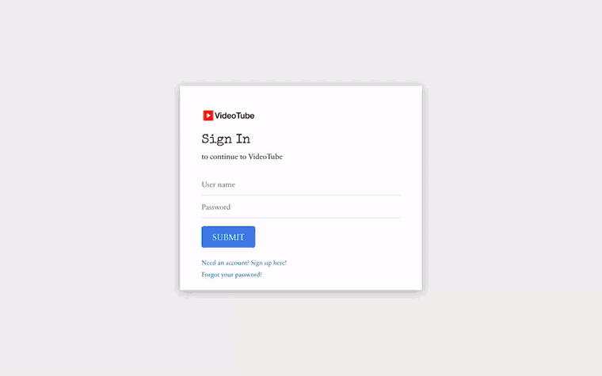

## Contents

- [Features](#features)
- [Screenshots](#screenshots)
- [Requirements](#requirements)
- [Installation](#installation)
- [Development](#development)
- [License](#license)

## Features

**Watching and sharing**

- Upload up to 50 MB per video; FFmpeg converts it to MP4 (up to 1280×720) in a background worker
- Three generated thumbnails to choose from; public or private visibility; edit or delete your own videos
- Streaming with byte ranges and browser caching; private videos are served only to their uploader
- Search, trending, recommendations, liked videos and a subscriptions feed

**Community**

- Channels with profile pictures and subscriber counts
- Comments with one level of replies, likes and dislikes; authors can delete their own comments
- Likes and dislikes on videos

**Accounts and safety**

- Email verification, password reset, password-protected email change, self-service account deletion
- Administration page for users, roles, suspension, videos, comments, upload jobs and an audit log
- CSRF protection on every POST, a strict Content-Security-Policy, rate limiting per address and per account
- Media stored outside the web root if you choose, under unguessable names

## Screenshots

| Home | Watch |
| --- | --- |
| 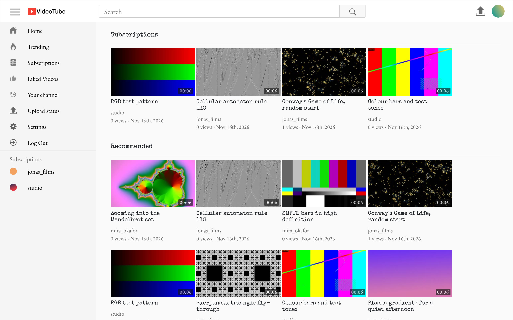 | 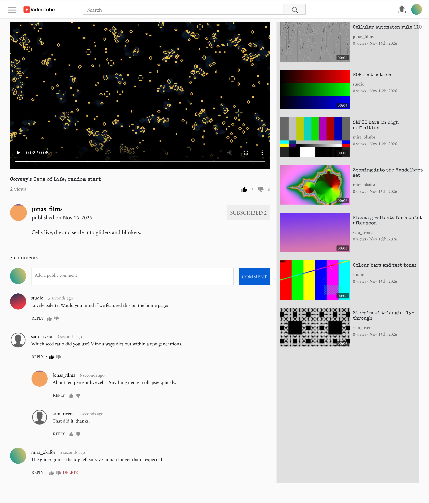 |

| Channel | Search |
| --- | --- |
| 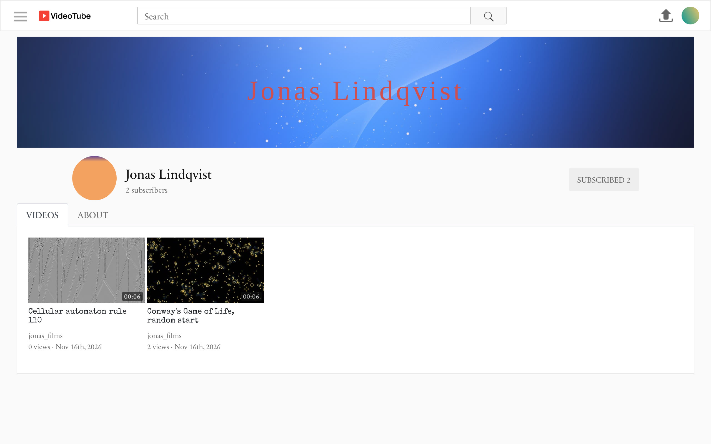 | 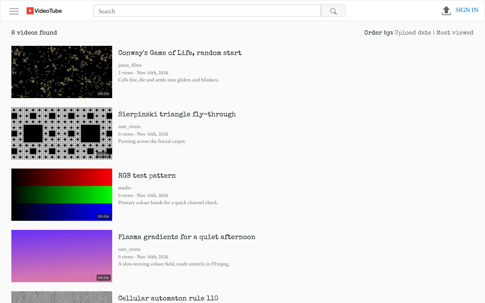 |

| Upload | Edit video |
| --- | --- |
| 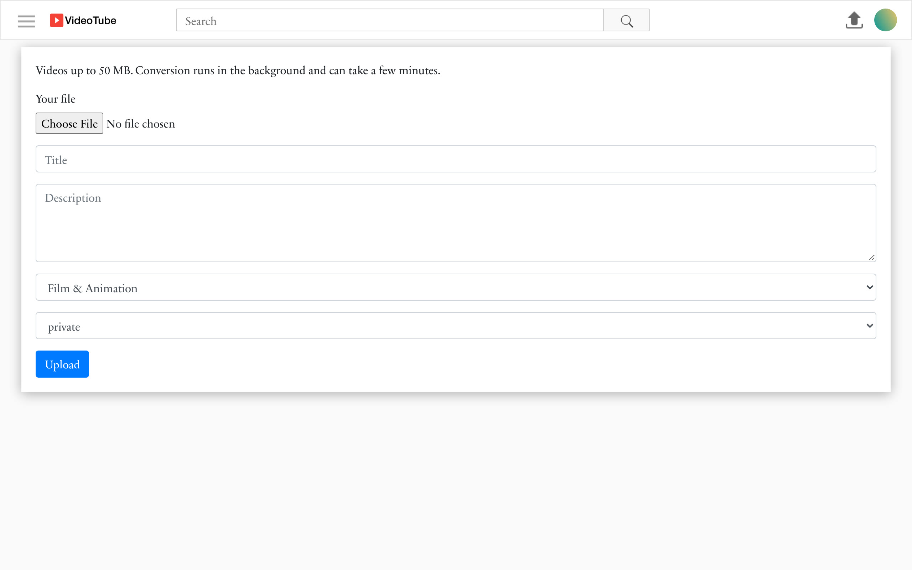 | 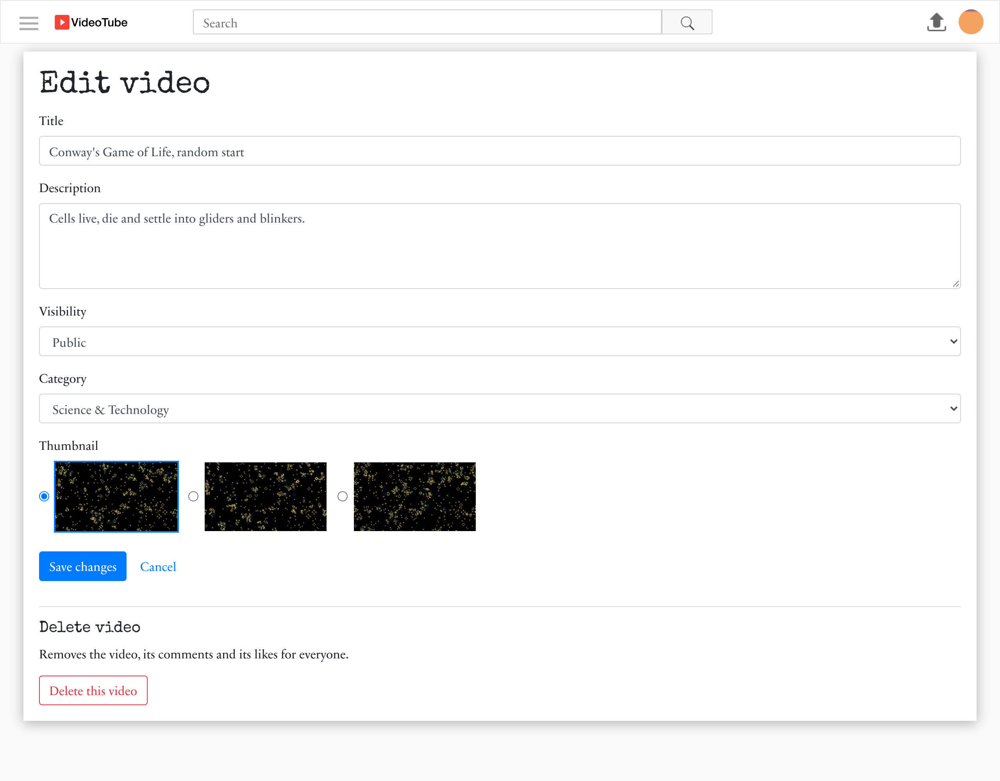 |

| Settings | Administration |
| --- | --- |
| 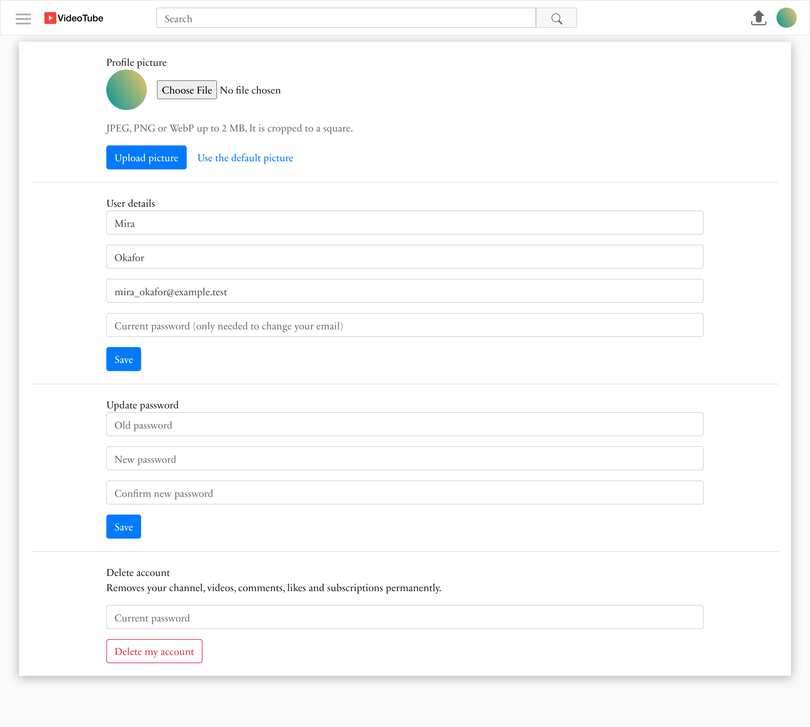 | 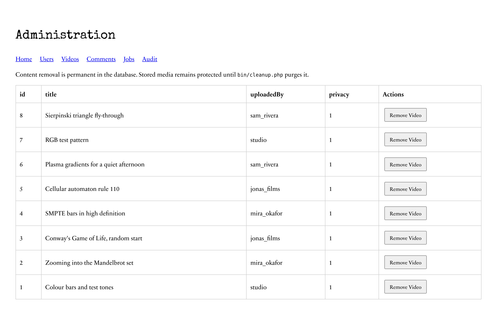 |

| Sign in | Sign up |
| --- | --- |
| 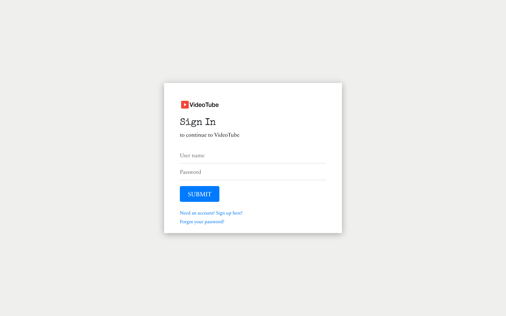 | 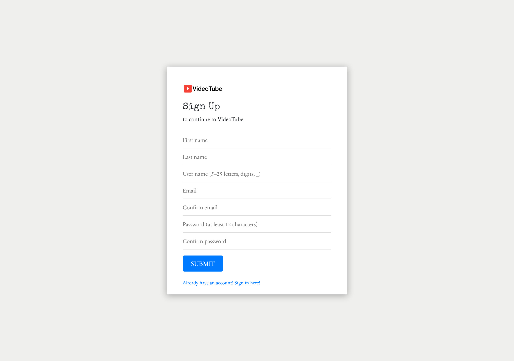 |

The videos in these pictures are FFmpeg test patterns from a demo instance.

## Requirements

- **PHP 8.4 or newer** with PDO MySQL and Fileinfo, and `proc_open` enabled (older PHP is rejected at start-up)
- MySQL 8 or MariaDB
- FFmpeg and FFprobe with libx264, AAC and JPEG support
- Apache or Nginx with HTTPS, and a way to run the worker (cron or systemd)

jQuery 3.7.1 and Bootstrap 4.6.2 are bundled in `assets/vendor/`; pages load nothing from other hosts.

## Installation

Follow [INSTALL.md](INSTALL.md). In short:

1. Apply the web-server rules (`.htaccess` for Apache, `deploy/nginx.conf.example` for Nginx) and create an empty database.
2. Set `VIDEOTUBE_INSTALL_TOKEN`, open `/install.php` and create the first administrator.
3. Set `VIDEOTUBE_BASE_URL` and `VIDEOTUBE_MAIL_FROM` so verification and reset emails can be sent.
4. Schedule `php bin/worker.php` (see `deploy/worker.service.example` and `deploy/worker.timer.example`).

Environment variables:

| Variable | Purpose |
| --- | --- |
| `VIDEOTUBE_DSN`, `VIDEOTUBE_DB_USER`, `VIDEOTUBE_DB_PASSWORD` | Database connection, overriding `includes/local.php` |
| `VIDEOTUBE_STORAGE` | Media directory, ideally outside the web root (default `uploads/`) |
| `VIDEOTUBE_FFMPEG`, `VIDEOTUBE_FFPROBE` | Paths to the media tools |
| `VIDEOTUBE_BASE_URL`, `VIDEOTUBE_MAIL_FROM` | Public URL and sender address for account emails |
| `VIDEOTUBE_HTTPS` | Set to `1` behind a proxy that terminates TLS |
| `VIDEOTUBE_TRUSTED_PROXIES` | Proxy addresses whose `X-Forwarded-For` is used for rate limiting |
| `VIDEOTUBE_MAX_TRANSCODE_SECONDS` | Ceiling for one conversion (default 3600) |
| `VIDEOTUBE_ACCEL_REDIRECT`, `VIDEOTUBE_XSENDFILE` | Let Nginx or Apache send media after PHP authorises it |

Maintenance commands:

```bash
php bin/worker.php
```

```bash
php bin/migrate.php --admin=YOUR_ADMIN_USERNAME --dry-run
```

```bash
php bin/cleanup.php --days=30
```

The worker processes queued uploads, `migrate.php` upgrades the database after a new release (replace `--dry-run` with `--backup-confirmed` to apply), and `cleanup.php` lists stored media nothing refers to any more (add `--delete` to remove it).

## Development

```bash
composer install
```

```bash
composer test
```

```bash
composer lint
```

`composer test` runs the fast regression checks on SQLite; `composer lint` checks PSR-12 style and `composer format` fixes it. The installation, migration, HTTP flow and web-server rule tests in `tests/` need MySQL, FFmpeg, Apache and Nginx and are run by the GitHub workflow in `.github/workflows/php.yml` on PHP 8.4 and 8.5.

Classes live in `includes/` and `includes/classes/`, one per file, and are loaded by `includes/autoload.php`. Page behaviour is attached in `assets/JS/` through `data-action` attributes, because the Content-Security-Policy forbids inline script.

## License

MIT, see [LICENSE](LICENSE). Bundled third-party files keep their own licences: jQuery and Bootstrap (MIT), Amiri (SIL Open Font License, `assets/fonts/Amiri-OFL.txt`).

Based on [VideoTube by manoharys](https://github.com/manoharys/VideoTube).
